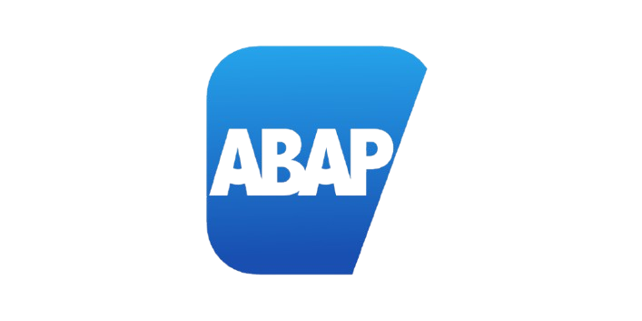

 

&nbsp;

---

### Tech stack

  

  
  &nbsp;&nbsp;
  

---

### GitHub stats

<picture>
  <source media="(prefers-color-scheme: dark)" srcset="assets/overview.dark.svg" />
  
</picture>

  <picture>
    <source media="(prefers-color-scheme: dark)" srcset="assets/languages.dark.svg" />
    
  </picture>
  <picture>
    <source media="(prefers-color-scheme: dark)" srcset="assets/contributions.dark.svg" />
    
  </picture>

